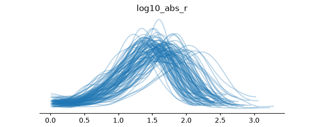
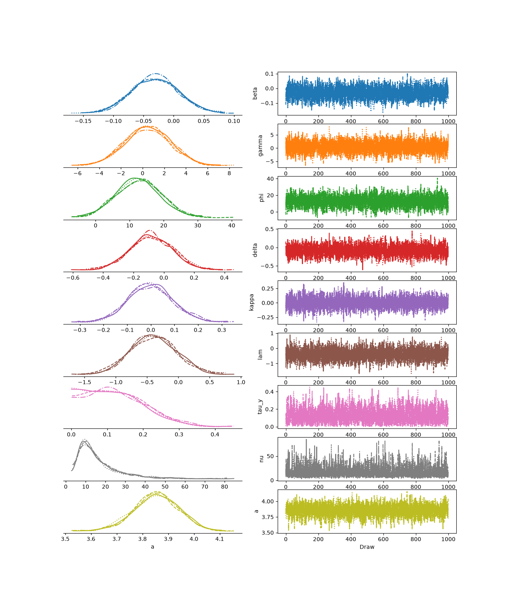
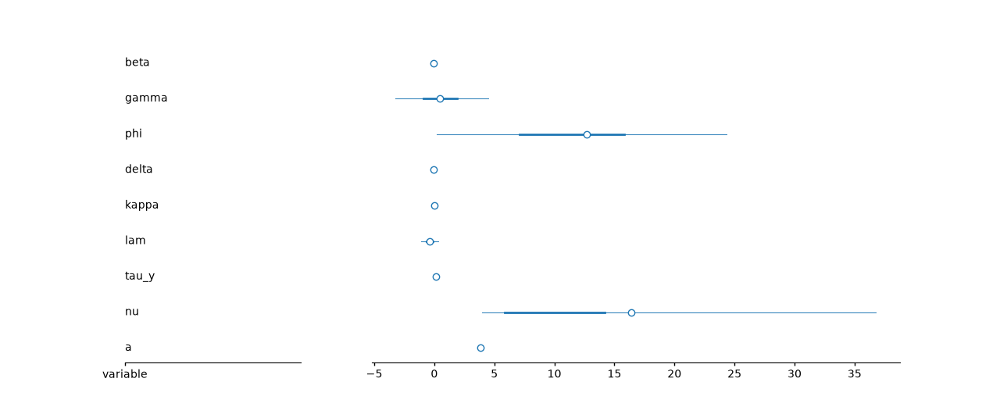
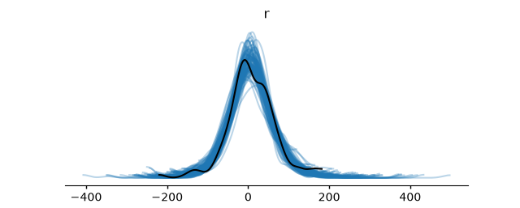
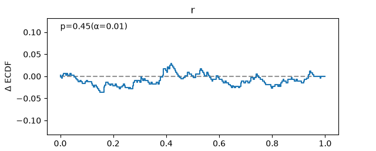
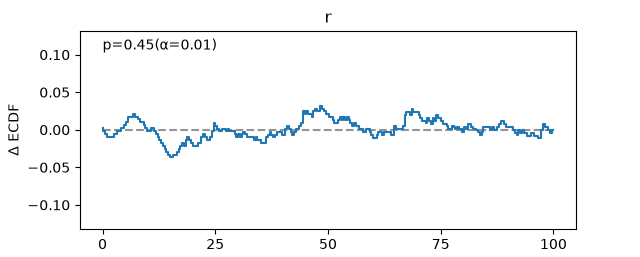
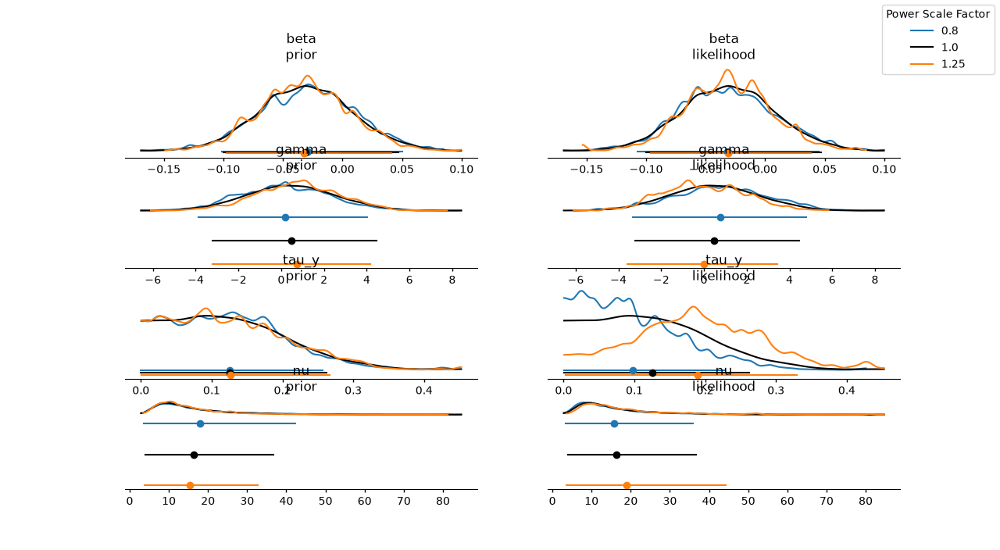

# Collection window and revision scale, total nonfarm, 2003–2026 — Bayesian Analysis Report

## Executive Summary

For the primary series (NSA, first to second estimate), the revision scale at a 19-business-day collection window is about 0.84 times the scale at 12 days. The 95% credible interval is about 0.5 to 1.4. So the data put roughly 8 chances in 10 on longer windows going with smaller revisions, but they cannot rule out no effect or an increase. A 7-day longer window could cut the revision scale by up to about half or raise it by up to about 40%. SA F→S and NSA F→T lean the same way, less strongly, and SA F→T, which the model fits less well, is centred on no effect. The main caveat: the identifying variation in the window is thin (a residual SD of about 1.35 days), and the window before the second release, which also acts on F→S, is not in the model. The four months whose release a lapse in appropriations delayed do not inform the window effect (deviation 4).

## Data and Question

| | |
|---|---|
| Source | BLS's revision table `cesnaicsrev` (`data/panel/panel.parquet`) joined to the collection-window day counts (`data/panel/collection_days.parquet`), through `signed_revisions` in `ces_revisions.collection_window` |
| Sample size | 258 reference months for F→S (January 2003 to July 2026) and 256 for F→T (to June 2026), across 23 reference years. March 2020 to December 2021 is held out, and 2025-09 and 2025-10 are dropped |
| Key variables | `r`: the signed revision in thousands (later estimate less first); `D_t`: federal business days from the first business day after the 12th to the first release (12 to 26); the 5-week survey-interval flag; the lapse flag (4 months); reference year; calendar month |
| Question | How does the scale (spread, not mean) of the revision change when the collection window grows from 12 to 19 business days? |
| Estimand (if causal) | `exp(7β)`: the ratio of revision scale at 19 days to 12, holding reference year, calendar month and the 5-week interval fixed. The design takes `D_t` as set by the calendar given those controls (`specs/stage-1-model-brief.md`) |

Each series has a small positive mean (+9 thousand for NSA F→S) and moderate tails (kurtosis 4–5 after local rescaling). The scale has a strong calendar-month pattern, from a mean |r| of about 25 thousand in March–April to 70 in August (NSA F→S). SA F→T is serially dependent (lag-1 autocorrelation 0.35). Values are rounded to whole thousands, which is negligible against a scale of 25–70 thousand.

## Model Specification

The model graph is not drawn: `numpyro.render_model` needs graphviz, which is not installed. The equations below give the same structure. The code is `src/ces_revisions/scale_model/model.py`.

**Generative story.** Each month's signed revision is drawn from a Student-t distribution. Its centre depends on the calendar month, the window and the 5-week interval. Its log scale depends on a partly pooled reference-year effect, the calendar month, the window (centered within year), the year's mean window, the 5-week interval and a lapse delay. Each of the four series is fit by itself (Fit 1 of the recommendation).

```math
r_t \sim \mathrm{StudentT}(\nu,\ \mu_t,\ \sigma_t)
```

```math
\mu_t = m + p_{m(t)} + \gamma \tilde D_t + \phi F_t
```

```math
\log \sigma_t = a + \tau_y z_{y(t)} + c_{m(t)} + \beta \tilde D_t + \kappa \bar D_{y(t)} + \delta F_t + \lambda L_t
```

$`\tilde D_t`$ is `D_t` less its year's mean over the non-lapse months (0 at a lapse month), and $`\bar D_y`$ is that year mean less the sample's (Mundlak 1978). So β rests only on within-year variation. The window also enters the location, so a window effect on the mean is not read as a change in scale.

| Parameter | Prior | Justification |
|-----------|-------|---------------|
| `a` | Normal(log 40, 0.5) | Observed σ is 36–62 thousand |
| `τ_y`, `z_y` | HalfNormal(0.3); Normal(0, 1), non-centered | Era means vary by about ±0.15 in log; 23 years of about 11 months each |
| `c` (12) | ZeroSumNormal(0.4) | Unpooled month effects on log scale. The observed month means have a log SD of 0.21–0.34. **Deviation:** the recommendation had 0.5 (see Prior Predictive Check) |
| `β` | Normal(0, 0.1) per day | The estimand. About 3 times the data-only SE of 0.033; refit at 0.05 and 0.2 |
| `κ` | Normal(0, 0.1) | Between-year window term |
| `δ` | Normal(0, 0.25) | 5-week interval, on log scale |
| `λ` | Normal(0, 0.5) | Only 4 lapse months, so the prior regularizes |
| `ν` | Gamma(2, 0.1) | Juárez–Steel; the measured kurtosis suggests ν near 5–10 |
| `m` | Normal(0, 10) thousand | Mean revision |
| `p` (12) | ZeroSumNormal(10) thousand | Unpooled month effects on the mean |
| `γ` | Normal(0, 5) thousand per day | Window effect on the mean |
| `φ` | Normal(0, 10) thousand | 5-week effect on the mean |

The model departs from the recommendation (`specs/stage-1-scale-model/recommendation.md` §6) in four places. Each run's provenance records them:

1. **No benchmark-cell term ω.** From 2004, the flagged cell (December for F→S, November for F→T) is the same calendar month in every year but 2003. One observation would identify ω against that month's effect, and the prior alone would set it. The month effect absorbs it. This does not affect β.
2. **The window is centered over non-lapse months only.** The lapse months (18–26 days) raise their year's mean by 1.03 days in 2013 and 0.6 days in 2025 and 2026. With partly pooled year effects, that common shift could leak into β.
3. **Month effects on log scale have prior SD 0.4, not 0.5.** This follows the prior predictive check below.
4. **A lapse month's within-year window is 0.** A shutdown, not the calendar, set the 18–26 days of the 4 lapse-delayed months. With their real windows (2 to 10 days above their year mean), those months leveraged β and γ. With a window of 0, they inform neither window effect: on log scale λ absorbs them, and on the mean they keep only their month and 5-week terms (the location has no lapse term). So β and γ rest on the calendar's variation only. The owner chose this on 2026-11-17, after the code review.

## Prior Predictive Check



The prior predictive distribution shows the data the model would generate before seeing any observations, using only the priors. Plausible Bayesian models produce prior predictive samples that span — but do not wildly exceed — the range of the observed data. Tightly bunched priors that exclude the observed range indicate priors that are too narrow; priors that produce wildly implausible values (e.g., negative blood pressure, billion-dollar daily revenue) indicate priors that are too wide and should be tightened before sampling.

**Assessment:** The figure shows log10(|r| + 1) for 100 of 500 prior draws on the NSA F→S design. Simulated |r| has a 1% to 99% range of 0.5 to 310 thousand, which covers the recommendation's target of about 2 to 300. Only 0.1% of the values exceed 1,000 thousand, which is above any revision of 1979–2026. With the recommended month-effect prior of 0.5, the central 90% of adjacent-month scale ratios was 0.27 to 3.7, against a target of about 0.3 to 3. The data's own adjacent-month ratios of mean |r| run from 0.46 to 2.19. At 0.4 the interval is 0.33 to 3.04. That misses the coded bound of 3.0 by 0.04, and `prior-predictive.json` records `ratio_within_target: false`. The prior was accepted without more tuning: a target worded as "about 3" does not justify tuning the prior again to clear a hard edge. Before this change, a 200-draw exploratory fit of NSA F→S at the recommended priors ran to check the run harness, and it showed β's posterior. The change targets `c` and follows from the prior check, so it does not bear on the estimand. The implied prior on the estimand `exp(7β)` has a 95% range of 0.25 to 3.9.

## Sampling and Convergence

Each fit ran 4 chains of 1,000 warmup and 1,000 draws through the run harness (`ces_revisions.runs.run_nuts`), from dispersed starts, at a target acceptance of 0.95. Each default fit took under 5 seconds on the Mac, compilation included. The table is the primary series. All 12 fits (4 series × 3 β priors) meet Req 18.

| Diagnostic | Value | Threshold | Status |
|------------|-------|-----------|--------|
| Max R-hat | 1.003 | ≤ 1.01 | ✓ |
| Min ESS (bulk) | 1340 | ≥ 100 × n_chains | ✓ |
| Min ESS (tail) | 1984 | ≥ 100 × n_chains | ✓ |
| Divergences | 0 | 0 (or near zero) | ✓ |
| Max relative MCSE | 0.027 (`tau_y`) | ≤ 0.05 (from `diagnostics.json → precision`; `check_diagnostics.py` flags a higher value) | ✓ |



The trace plot checks chain mixing. It draws the sampled values against the iteration number, one line per chain, and marks divergent transitions as a rug when any occurred. Well-mixed chains overlap and look like stationary noise around the same level. Visible separation between chains, monotone drift, or stuck chains indicate non-convergence and the posterior should not be interpreted.

**Assessment:** `check_diagnostics.py` reports that all convergence diagnostics passed (R-hat ≤ 1.01, ESS adequate, no divergences) for all four series, with excellent Monte Carlo precision (max relative MCSE 0.024–0.029, on `tau_y`). The run harness's Req 18 checks also pass in all 12 fits: E-BFMI is at least 0.73 in every chain, and no draw reaches the maximum tree depth of 10 (the longest trajectory has 95 of 1,023 steps).

## Posterior



The forest plot shows posterior means (points), 50% credible intervals (thick lines) and 94% HDIs (thin lines) for the parameters of interest. Wide intervals indicate parameters the data are only weakly informative for; narrow intervals concentrated away from zero indicate strong evidence in a direction.

The primary series, NSA F→S. Each value is rounded to its stable digits from `diagnostics.json → precision`.

| Parameter | Mean | SD | 94% HDI | P(>0) |
|-----------|------|----|---------|-------|
| `β` (log scale per day) | −0.03 | 0.04 | [−0.10, 0.05] | 0.2 |
| `exp(7β)` (scale ratio, 19 to 12 days) | 0.84 | 0.23 | [0.4, 1.3] | — |
| `γ` (thousand per day, on the mean) | 0.5 | 2.1 | [−3.2, 4.5] | 0.6 |
| `φ` (thousand, 5-week, on the mean) | 13 | 6.5 | [0, 24] | 0.98 |
| `δ` (5-week, log scale) | −0.08 | 0.14 | [−0.34, 0.18] | 0.3 |
| `κ` (year-mean window, log scale) | 0.00 | 0.09 | [−0.17, 0.18] | 0.5 |
| `λ` (lapse, log scale) | −0.4 | 0.37 | [−1.07, 0.31] | 0.1 |
| `τ_y` | 0.13 | 0.08 | [0.00, 0.26] | — |
| `ν` | 16 | 11 | [4, 37] | — |
| `a` | 3.85 | 0.09 | [3.69, 4.03] | — |

The estimand in each series, with the equal-tailed intervals that the recommendation asks for. An equal-tailed interval of `exp(7β)` is exactly `exp(7·)` of β's interval. The endpoints are rounded to 0.1, because their Monte Carlo error is up to 0.018.

| Series | Scale ratio, mean | 90% interval | 95% interval | P(ratio < 1) | `γ`, thousand per day (95%) |
|---|---:|---:|---:|---:|---:|
| **NSA F→S (primary)** | **0.84** | **0.5 to 1.3** | **0.5 to 1.4** | **0.8** | 0.5 (−3.6 to 4.5) |
| SA F→S | 0.92 | 0.6 to 1.4 | 0.5 to 1.5 | 0.7 | 0.4 (−2.9 to 3.5) |
| NSA F→T | 0.87 | 0.5 to 1.3 | 0.5 to 1.4 | 0.7 | 0.5 (−3.8 to 4.9) |
| SA F→T (secondary) | 1.08 | 0.7 to 1.6 | 0.6 to 1.8 | 0.4 | −1.2 (−5.0 to 2.6) |

**Substantive interpretation.** A longer collection window should put more of the sample into the first estimate, so the expected sign of β is negative. In the three primary-quality series, the posterior leans that way: there is about a 70–80% probability that revisions are smaller at 19 days than at 12. But the size is not pinned down. At 19 days the NSA F→S scale is somewhere between about 0.5 and 1.4 times its scale at 12 days. So the data rule out an increase in scale of more than about 40%. They allow anything from that to a cut of about half. The window has no clear effect on the mean (`γ` is centred near zero). The 5-week interval raises the mean NSA F→S revision by about 13 thousand (`φ`, 94% HDI 0 to 24), but it has no clear effect on scale (`δ`). Stage 1's OLS gave a 95% interval of about −23 to +20 thousand for the same contrast in mean |r|, but on the 1979–2026 sample, so the two are not directly comparable. SA F→T is centred on no effect, and its interval is too narrow for the reason given under Limitations.

## Posterior Predictive Check



The posterior predictive distribution shows what the fitted model implies the data should look like. A well-fitting model produces replicated samples that closely overlap the observed data across the full range. Systematic discrepancies — the model under-predicts the tails, misses a mode, or over-disperses — indicate model misspecification and should be addressed before drawing conclusions.

**Assessment:** The replicated distributions cover the observed one in all four series, tails included. The recommendation's test statistics (each series' `posterior_predictive_checks` in `fit-beta0.1.json`; the p-value is P(T(y_rep) ≥ T(y))) mostly fall inside their replicated ranges. That holds for the kurtosis of the standardized revision (p = 0.31–0.60), mean |r| by calendar month (August, September and December against March and April included), and mean |r| by survey interval. There are three misses:

1. **SA F→T is serially dependent, as the recommendation expected.** Its lag-1 autocorrelation of `r` is 0.35 against replicated values near 0 (p < 0.001). Its lag-1 autocorrelation of |r| (0.22 against a replicated median of 0.06, p = 0.02) and its lag-12 autocorrelations of `r` and |r| (p = 0.006 and 0.010) also miss. The |r| lag-1 miss is the AR(1) trigger that the recommendation (§4) names. The model's conditional independence fails for this series, so it stays secondary.
2. **Window cells in three of the four series.** In SA F→S, months with a 16-day window have smaller revisions than predicted (mean |r| 22 against a replicated median of 29, p = 0.97). In NSA F→S, two cells miss. Months with a 15-day window have smaller revisions than the model predicts (mean |r| 28 against a replicated median of 44, p = 0.99). Months with an 18-day window have larger ones (51 against 40, p = 0.04). NSA F→T shows the same two cells at the edge (p = 0.96 and 0.05). The pattern is not monotone in the window, so it does not point to a steeper window effect. It does say that the log-linear form is an approximation, or that cell means of about 30–60 months are noisy. NSA F→S and NSA F→T share the F→S part, so the two series are not independent evidence here.
3. **A 12-month echo in the NSA mean.** The lag-12 autocorrelation of `r` is 0.16 (NSA F→S, p = 0.05) and 0.19 (NSA F→T, p = 0.02). The fixed month effects on the mean do not capture year-to-year changes in the seasonal pattern. This bears on the location, not on the scale effect.

With 26 statistics per series, a few p-values outside 0.05–0.95 are expected by chance. Only the SA F→T misses are large.

## Calibration



The PIT-ECDF plot tests whether the model's predictive distribution is calibrated — that is, whether stated credible levels match empirical coverage. It plots the difference between the empirical CDF of the probability integral transform values and the uniform reference, so a calibrated model stays near the dashed zero line; no band is drawn around it — the panel carries a uniformity-test p-value with the α it is judged against, and points are highlighted only when that test rejects. That p-value is `pit_p_value` in `calibration.json` (`coverage_p_value` on the coverage plot below), judged against its `alpha`: `calibration_check.py` draws both figures from the same PIT values its verdict reads. Read the curve's *shape*, not a global sign: in the raw PIT ECDF neither miscalibration sits wholly above or below the zero line — both trace a sign-flipping slope that integrates to ≈0. A predictive that is too narrow runs above the zero line in the lower half and below it in the upper half; one that is too broad mirrors that. A predictive with the right spread but an off-centre location is the exception: it sits above the zero line when predictions run too high and below it when they run too low. A shift keeps the curve on one side of the zero line, while a curve that crosses it points at shape rather than location. `calibration.json` names every failing component, so one failed check never hides another: `biased (predictions too high)` or `biased (predictions too low)` when the PIT test fails and the mean PIT sits significantly off 0.5 (its `location_t`); `over-confident` or `under-confident` when the coverage test fails; both together when both hold; and `shape mismatch` when the PIT test fails and neither a shift nor a spread error explains it. For spread, the single-signed reading belongs to the coverage plot below. See `references/model-criticism.md` in the bayesian-workflow skill.



The coverage plot tests the same idea in coverage units: it asks whether nominal central credible intervals (50%, 80%, 95%) actually contain the stated fraction of the observed data. A well-calibrated model lies on the zero line. Here the deviation *is* single-signed, so it reads directly: above → under-confident (intervals wider than they should be); below → over-confident (intervals too narrow).

**Assessment:** `check_diagnostics.py` rates the calibration of all four series as excellent (well-calibrated), by LOO-PIT. The PIT p-values are 0.32–0.46 and the coverage p-values 0.30–0.45, each against α = 0.01. The mean coverage deviation is at most 0.012 in absolute value. LOO-PIT tests each month's marginal predictive distribution, so it cannot see SA F→T's serial dependence.

PSIS-LOO by reference month: Pareto k is above 0.7 for no month of NSA F→S (largest 0.69), 1 of SA F→S (2024-01; 0.70), 2 of NSA F→T (2022-02 and 2024-01; 0.76–0.84) and 2 of SA F→T (2008-10 and 2026-05; 0.71–0.73). `check_diagnostics.py` rates NSA F→S excellent and the other three "poor", and PSIS-LOO is unreliable at those points. No lapse month is among them. By the recommendation, no data are excluded on that basis. Blocked by reference year, LOO is unreliable for several years (SA F→T's 2008 and 2025 have k above 1, and NSA F→T's 2024 has 0.95). LOO's role here is model criticism only: the comparison of A with A′ that would rank models on it is deferred.

## Simulation-Based Calibration

SBC ran 100 replicates on the NSA F→S design (`ces_revisions.scale_model.sbc`). Each replicate drew the parameters from the prior, simulated revisions, fit one NUTS chain (500 warmup, 1,000 draws, target acceptance 0.95) and ranked the true value among 100 evenly spaced draws. The pass rule was fixed in code before any replicate ran. Every scalar site and the log likelihood at the true parameters must pass the γ-ECDF test (Säilynoja et al. 2022) at the Bonferroni level 0.05 / 11. And β must contract by a median of at least 0.5, with at most 5% of replicates beyond |z| = 3.

**Result: passed.** No quantity failed the ECDF test. The smallest γ statistic was 0.0044 (the log likelihood), against a critical value of 0.0003. β's median contraction was 0.84, and no replicate had |z| above 3. No replicate diverged or reached the maximum tree depth. The median replicate took 6.7 seconds. Under the model, β's credible interval has the coverage it claims. (`sbc-summary.json`)

## Prior Sensitivity



| Parameter | Prior | Likelihood | Diagnostic |
|-----------|-------|------------|------------|
| `β` | 0.053 | 0.053 | Flagged "potential prior-data conflict", just above the threshold. The refits below show the estimate barely moves |
| `exp(7β)` | 0.077 | 0.078 | Flagged "potential prior-data conflict". The same refits apply |
| `γ` | 0.112 | 0.170 | Prior-data conflict flag. The Normal(0, 5) prior is about 2.5 times the posterior SD; not the estimand |
| `δ` | 0.102 | 0.079 | Prior-data conflict flag |
| `τ_y` | 0.050 | 0.610 | Not flagged, at the threshold. The high likelihood sensitivity means the data inform it |
| `ν` | 0.260 | 0.163 | Prior-data conflict flag. The Gamma(2, 0.1) prior shapes the tail weight as much as the data do |

(NSA F→S, from `psense.json`; the threshold is 0.05. The other series are in their own `psense.json`. β's prior sensitivity there is 0.032–0.047, not flagged. In SA F→S `exp(7β)` is flagged (0.066 prior, 0.132 likelihood).)

The recommendation's direct test refits each series with β's prior SD at 0.05, 0.1 and 0.2. The rule is that β's posterior mean moves by less than half its data-only SE (0.017) between the 0.1 and 0.2 runs (`sensitivity.json`):

| Series | β mean (SD) at prior SD 0.05 | at 0.1 | at 0.2 | Shift, 0.1 to 0.2 | Rule |
|---|---:|---:|---:|---:|---|
| NSA F→S | −0.022 (0.032) | −0.031 (0.039) | −0.036 (0.041) | 0.005 | passed |
| SA F→S | −0.013 (0.033) | −0.017 (0.040) | −0.021 (0.043) | 0.004 | passed |
| NSA F→T | −0.018 (0.032) | −0.025 (0.039) | −0.029 (0.040) | 0.004 | passed |
| SA F→T | +0.003 (0.032) | +0.006 (0.038) | +0.006 (0.042) | < 0.001 | passed |

**Assessment:** The prior on β does not shape the answer: its mean moves by at most 0.005 when the prior SD doubles. The 0.05 prior pulls β towards zero, by construction. psense flags `ν`, `γ` and `δ` in NSA F→S, and `τ_y` in the other three series. It flags the estimand itself near the threshold: β and `exp(7β)` in NSA F→S, and `exp(7β)` in SA F→S. The direct refits are the stronger test, and they move β by at most 0.005. The prior on ν does shape the fitted tail weight.

## Limitations and Threats

1. **The window before the second release is omitted.** The F→S revision also depends on how long collection ran before the second estimate. If that window is correlated with `D_t` given the controls, β is biased, in a direction that is not known. Adding it changes the conditioning set, so it is the owner's decision (open question 1 of the recommendation).
2. **The lapse months are a modeling choice.** A shutdown, not the calendar, set the windows of the 4 lapse-delayed months, so their window enters as 0 (deviation 4). Before this change their centered windows (2 to 10 days) stayed in the β term and leveraged it. The change moved NSA F→S β from −0.044 to −0.031, and P(ratio < 1) from 0.88 to 0.79. A PSIS reweighting that left the four months out had predicted about −0.027 and 0.77. It also moved γ, the window effect on the mean, from −0.8 to +0.5 thousand per day, still centred near zero. The earlier runs are kept in `data/runs/superseded-lapse-window/`.
3. **The identifying variation is thin.** After year, month and 5-week controls, `D_t` has a residual SD of about 1.35 days. That is why the interval spans a halving to a 40% increase. More months will not change this much; the first-closing collection rates of Stage 9 (O3) are the sharper test of the mechanism.
4. **The window effect is log-linear.** The 15- and 18-day cells (NSA F→S, and NSA F→T at the edge) and the 16-day cell (SA F→S) miss. A non-monotone effect would not be captured. The interval holds for the log-linear summary only.
5. **SA F→T's intervals are too narrow.** Its revisions are serially dependent (lag-1 autocorrelation 0.35), which the model does not include. Treat it as secondary. Whether the cause is concurrent seasonal-factor revision is open question 3 of the recommendation.
6. **The four series are not independent evidence.** NSA F→T contains the NSA F→S revision (|r| correlation 0.90), and the NSA and SA series share the first estimate. The joint fit with a pooled β (Fit 2) is deferred.
7. **The sample is 2003–2026 only** (the owner's choice, for the probability-sample redesign). The result says nothing about 1979–2002.
8. **The evidence predates later code changes.** Each fit and the SBC ran from commit `5060545` with a clean tree, as their provenance records. A later change to `src/ces_revisions/scale_model/` or the run harness needs a refit before these figures still hold.

## Suggested Next Steps

1. **Decide where the result lands** (open question 2 of the recommendation). It could replace the OLS tables in `specs/ces-revision-drivers-stage-1-findings.md` or sit beside them. Those findings are not changed here.
2. **Run Fit 2 and the A′ comparison.** Fit 2 is the joint fit with the F→T increment and a pooled β. A′ has a random walk on the year effects. For the LOO comparison, get exact values at the months with Pareto k above 0.7 (`azs.reloo`, one refit each). The year-blocked LOO is unreliable for SA F→T.
3. **Settle SA F→T.** Confirm the cause of its lag-1 dependence (`bls-data-context`), then add an AR(1) term on the signed residual or keep it secondary.
4. **Decide on the second release's window** (open question 1) before treating β as the window's full effect on F→S.
5. **Fit the Gamma GLM cross-check** against the OLS, as the recommendation lists.

## Appendix

- **Code:** `src/ces_revisions/scale_model/` (`data.py`, `model.py`, `checks.py`, `fit.py`, `sbc.py`) and `scripts/scale_model_run.py`. Tests: `tests/test_scale_model*.py` and two new tests in `tests/test_collection_window.py`.
- **Commands** (after `uv run python scripts/vintage_sources.py build` and `uv run python scripts/operator_artifacts.py build`):
  1. `uv run python scripts/scale_model_run.py prior-predictive`
  2. `uv run python scripts/scale_model_run.py fit --beta-sd 0.05 0.1 0.2`
  3. `uv run python scripts/scale_model_run.py sensitivity`
  4. `uv run python scripts/scale_model_run.py sbc --replicates 100 --workers 4`, then `sbc-summary`
  5. The skill's `diagnose_model.py`, `calibration_check.py --loo-pit` and `check_diagnostics.py` on each default fit's `inference_data.nc`
- **Seeds:** fits 1765 (`sum(map(ord, "stage-1-scale-model"))`); initial draws, posterior predictive and prior predictive seeds are derived the same way in `scale_model/fit.py` and the driver. SBC base seed 2122.
- **Run directories** (gitignored, `data/runs/`): `stage1-scale-<series>-beta<sd>-seed1765-<UTC stamp>`, named in each `fit-beta<sd>.json`; `stage1-scale-sbc/`.
- **Software:** NumPyro 0.21.0, JAX 0.11.1, ArviZ 1.3.0, Python 3.14, float64, on the Mac (CPU, 4 host devices).
- **Evidence in this folder:** `prior-predictive.json`, `sensitivity.json`, `sbc-summary.json`, and for each series `fit-beta{0.05,0.1,0.2}.json`, `diagnostics.json`, `calibration.json`, `check_report.json`, `psense.json`, `summary.csv` (the full ArviZ summary), and the figures.
